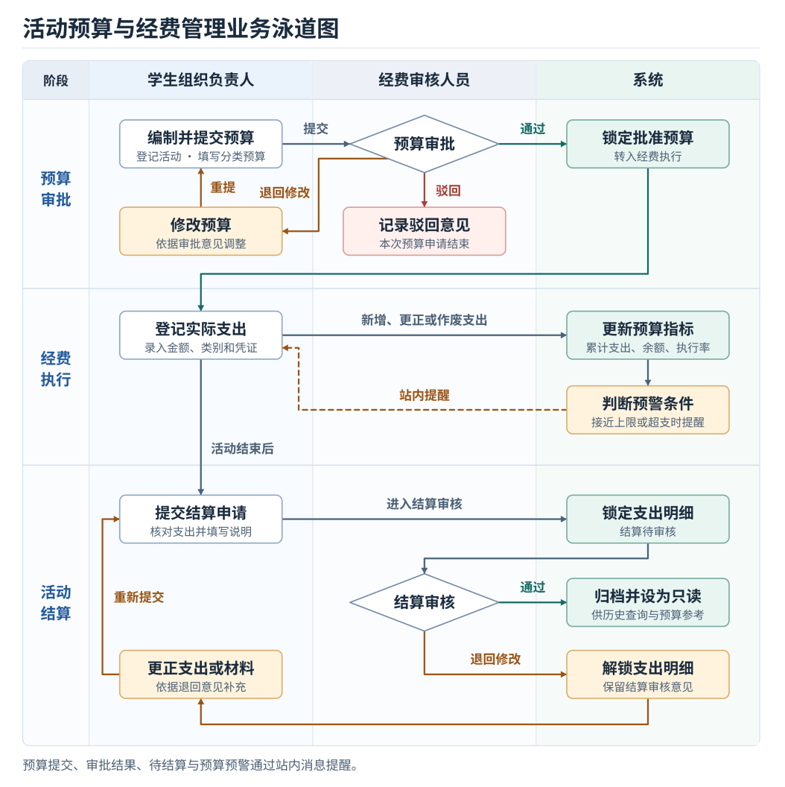
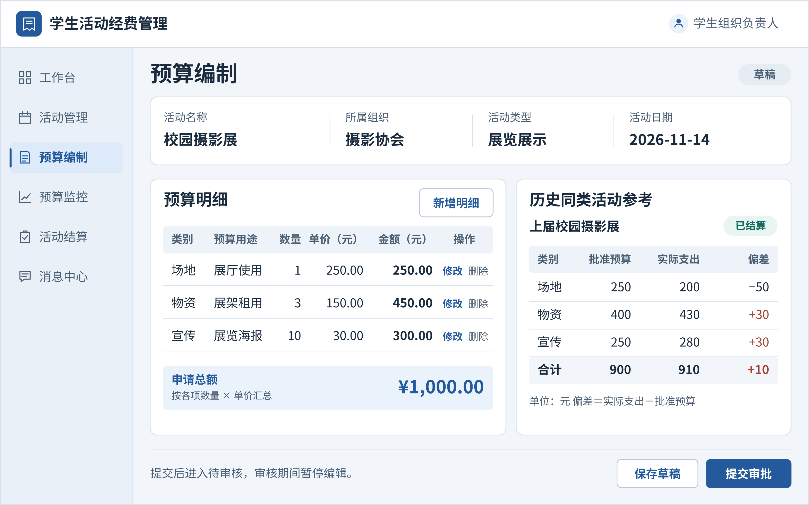
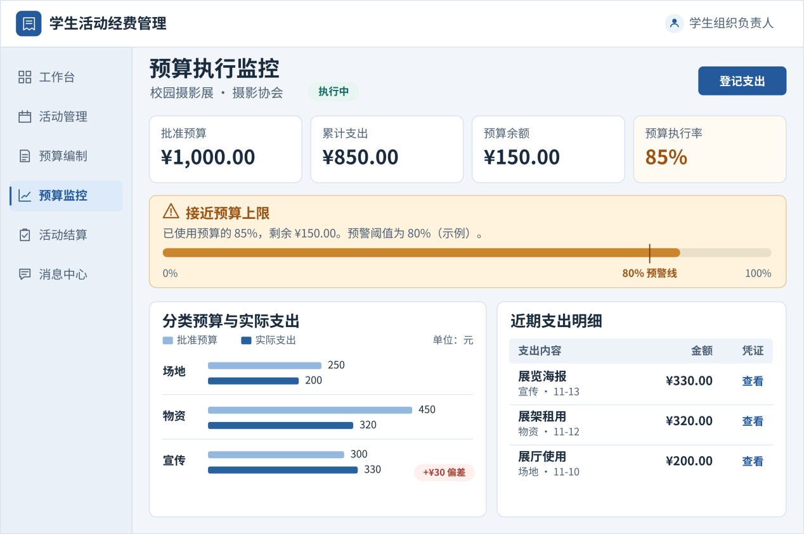

# 高校学生组织活动预算与经费执行管理系统

**甲方总体需求说明书 · V1.0**

## 一、项目背景与建设目标

高校学生会、社团等学生组织举办活动时，需要在活动前编制经费预算，在筹备和开展过程中记录实际支出及凭证，并在活动结束后核对支出、办理结算。如果预算表、审批意见和支出凭证分散在不同渠道，负责人就难以及时了解审批进度和预算余额，结算时也需要反复核对。

本项目拟建设高校学生组织活动预算与经费执行管理系统。系统以单项活动为管理单位，支持活动登记、预算编制与审批、支出及凭证登记、预算执行监控、结算审核与归档，并提供经费统计和历史查询功能。
assets/budget-form.png
系统应保留预算和结算的审核记录，便于负责人查询审批进度和处理意见。支出记录变动后，系统应根据批准预算更新累计支出、预算余额和执行率，并在支出接近或超过预算上限时发出提醒。负责人还可查看历史同类活动的预算与实际支出差异，为下一次编制预算提供参考。

## 二、系统用户与权限需求

系统面向学生组织负责人、经费审核人员和系统管理员三类用户。各角色的职责和数据访问范围如下。

| 用户角色 | 主要职责 | 数据访问范围 |
| --- | --- | --- |
| 学生组织负责人 | 登记活动，编制并提交预算，查询审批进度和意见，登记实际支出及凭证，查看预算执行情况，提交结算申请并查询历史记录。 | 本组织的活动、预算、支出、凭证和结算记录。 |
| 经费审核人员 | 审核预算和结算申请，填写审核意见，核查支出凭证及超支说明，查看经费统计。 | 配给其审核的学生组织及其经费记录。 |
| 系统管理员 | 负责用户账号、角色权限、审核范围及学生组织和基础数据的维护。 | 用户账号、组织信息、权限配置和基础数据。 |

系统应在查询、修改、审批、凭证查看和统计等操作中校验用户角色及数据访问范围。预算和支出的修改权限还应受当前业务状态约束。

## 三、系统功能需求

### 3.1 用户与权限管理

- A. 支持用户登录、退出，并根据角色提供相应的功能入口。
- B. 系统管理员可新增、编辑和停用用户账号，分配角色及审核范围，并维护学生组织、活动类型和支出类别等基础数据。
- C. 系统应按第二章规定校验用户的操作权限和数据访问范围。

### 3.2 活动与预算管理

- A. 学生组织负责人可登记、编辑和查询本组织活动。活动信息包括名称、类型、起止时间、地点、所属组织、预计参与人数及活动说明。
- B. 支持按场地、物资、宣传、交通等类别编制预算。预算明细包括类别、用途、数量和单价。系统按数量与单价计算单项金额，并自动汇总预算总额。
- C. 负责人可新增、修改和删除草稿或退回修改状态的预算明细，保存草稿或提交审批，并查询申请状态和历史记录。

### 3.3 经费审批管理

- A. 经费审核人员可在授权范围内查看待审申请、活动信息、预算明细和申请说明。
- B. 预算审批结果包括通过、退回修改和驳回。通过后，系统锁定批准预算，活动进入经费执行阶段。退回修改后，申请人可按意见调整并重新提交。驳回后，本次申请结束。退回或驳回时应填写原因。
- C. 预算待审期间暂停编辑。系统应保留历次申请和审批记录，包括审批人、审批时间、审批结果及意见，供申请人查询。

### 3.4 经费支出管理

- A. 预算批准后，学生组织负责人可登记实际发生的支出。支出记录应关联相应活动及其批准预算，并记录金额、类别、日期、用途和凭证。
- B. 在业务状态允许时，负责人可查询、更正或作废支出。系统应记录更正和作废的操作人、时间及变更内容或原因。作废记录保留，且不计入累计支出。
- C. 已发生的超预算支出仍可登记。提交结算时，负责人应填写超支说明，供审核人员核查。

### 3.5 预算执行监控与预警

- A. 系统在支出新增、更正或作废后，重新计算累计支出、预算余额、预算执行率和超支金额，并通过数据卡片和进度条展示。
- B. 累计支出为有效支出记录的金额合计。预算余额为批准预算减去累计支出，最低为 0 元。预算执行率为累计支出除以批准预算后转换成百分比。超支金额为累计支出超过批准预算的部分。
- C. 执行率达到 80% 且低于 100% 时，提示接近预算上限。执行率等于 100% 时，提示预算已用完。累计支出超过批准预算时，提示已超支，并显示对应活动和超支金额。
- D. 批准预算为 0 元时，执行率显示为「不适用」。发生实际支出时，按超支处理。

### 3.6 经费统计与分析

- A. 支持在授权范围内按活动、学生组织、活动时间和支出类别进行查询和统计，展示批准预算、实际支出、预算偏差及各类支出占比。预算偏差为实际支出减去批准预算。
- B. 支持用柱状图对比预算与实际支出，用饼图展示各类支出占比。
- C. 编制预算时，负责人可查看有权访问的同类型已结算活动，并参考其分类预算、实际支出和偏差。

### 3.7 活动结算与历史记录管理

- A. 活动结束后，负责人可核对支出明细和凭证，查看系统生成的预算与实支对比，填写结算说明并提交申请。
- B. 提交结算后，系统锁定支出明细。审核人员可通过或退回结算申请，并记录审核结果及意见。退回后，系统解锁支出明细，负责人可更正后重新提交。
- C. 结算通过后，系统将该活动的预算、审批、支出、凭证和结算记录归档。归档后的经费记录仅供授权用户查询。

### 3.8 消息提醒

- A. 提交或重新提交预算、结算申请时，系统通知对应审核人员。审核完成后，系统将结果通知申请人。
- B. 预算进入预警状态或预警等级升高时，系统提醒学生组织负责人；发生超预算时，同时提醒对应经费审核人员。活动登记的结束时间已过，若已有批准预算但尚未提交结算申请，系统生成待结算提醒。
- C. 消息通过站内发送，支持查看消息列表、关联活动及已读和未读状态，并可将消息标记为已读。

## 四、系统业务流程需求

用户登录后，进入与其角色对应的工作台。活动经费管理依次经过预算申请、经费执行和活动结算，具体流程见图 4-1。

### 4.1 活动登记与预算提交

学生组织负责人登记活动，填写预算明细，核对系统汇总的预算总额后提交申请。提交后，预算进入待审批状态，系统暂停预算编辑，并通知经费审核人员。

### 4.2 预算审批

经费审核人员查看活动信息和预算明细后作出审批决定。审批通过时，系统锁定批准预算，活动进入经费执行阶段。退回修改时，负责人可根据审批意见调整预算并重新提交。驳回时，系统记录原因，本次申请结束。审批结果通过站内消息通知申请人。

### 4.3 支出登记与预算监控

在经费执行阶段，负责人登记实际支出及相关凭证。每次新增、更正或作废支出后，系统同步更新累计支出、预算余额和执行率，达到预警条件时向负责人发送站内提醒；发生超预算时，同时通知对应审核人员。发生超支时，负责人应如实登记支出，并在结算时说明原因。

### 4.4 结算申请与审核

活动结束后，负责人核对实际支出及凭证，查看预算与实支的对比结果，填写说明并提交结算申请。系统在结算待审期间锁定支出明细。审核通过后，活动进入归档阶段。若审核退回，系统解锁支出明细，负责人按意见更正后可重新提交。

### 4.5 归档与历史查询

结算通过后，系统归档该活动的预算、审批、支出、凭证及结算记录。归档记录在授权范围内可查询，并可用于经费统计和预算偏差分析。同类型的已结算活动可作为后续预算编制的参考。

*图 4-1 活动预算与经费管理业务泳道图*

## 五、系统界面设计需求

系统采用 Web 管理平台。登录后的界面由顶部栏、左侧功能菜单和右侧内容区域组成。顶部栏显示系统名称和当前用户身份，左侧菜单根据用户角色展示可使用的功能，右侧区域用于办理业务和查看数据。

表单应对必填项、金额、数量和日期等输入进行校验，并提示错误原因。提交审批、作废支出等操作应提供确认提示和处理结果。预算或支出处于锁定状态时，页面应显示当前状态及无法编辑的原因。

| 页面 | 主要内容 |
| --- | --- |
| 登录页面 | 账号和密码输入、登录操作及失败提示。 |
| 工作台首页 | 按角色展示活动概况、待办事项、预算预警和未读消息。 |
| 活动管理页面 | 活动列表、查询、登记、编辑及详情。 |
| 预算编制页面 | 活动信息、分类预算明细、自动汇总、历史同类活动参考、保存草稿和提交审批。 |
| 经费审批页面 | 待审批预算、活动及预算详情、审批意见和记录，以及通过、退回修改、驳回操作。 |
| 经费支出页面 | 支出明细、支出登记、更正或作废、凭证查看。 |
| 预算执行监控页面 | 批准预算、累计支出、预算余额、执行率、分类支出对比及预警。 |
| 统计分析页面 | 按组织、活动、时间和类别筛选，查看预算偏差和分类支出占比。 |
| 活动结算页面 | 支出核对、预算与实支对比、结算说明、提交与审核、归档记录查询。 |
| 消息中心 | 消息列表、关联活动查看和已读状态管理。 |
| 系统管理页面 | 用户账号、学生组织、角色权限、审核范围及基础数据管理。 |

预算编制页面与预算执行监控页面的原型分别见图 5-1 和图 5-2。

*图 5-1 预算编制页面原型*

*图 5-2 预算执行监控页面原型*

## 六、系统数据管理需求

系统以单项活动为单位管理经费数据，并保存下列信息。

| 数据类别 | 主要保存内容 |
| --- | --- |
| 用户与权限 | 用户账号、角色、所属组织、账号启停状态及审核范围。 |
| 组织与基础数据 | 学生组织、活动类型及支出类别。 |
| 活动信息 | 活动名称、类型、起止时间、地点、所属组织、预计参与人数、活动说明及状态。 |
| 预算申请与明细 | 历次提交的预算、分类明细、申请状态及批准预算。 |
| 审批记录 | 对应的预算或结算申请、审核人员、处理时间、结果及意见。 |
| 实际支出与凭证 | 支出金额、类别、日期、用途、凭证及作废状态。 |
| 活动结算 | 结算申请、预算与实支对比结果、结算说明及归档状态。 |
| 消息与操作记录 | 消息接收人、关联业务和已读状态，以及支出更正、作废的操作记录。 |

预算、支出和结算记录应关联到对应活动，审批记录应关联到当次提交的申请，凭证应关联到对应支出。活动进入经费执行阶段后，以该活动的批准预算为计算依据。

金额以人民币元记录，保留两位小数。预算监控、统计和结算应使用一致的支出汇总口径。作废支出保留记录，不计入累计支出。活动归档后，相关经费记录仅供授权用户查询。

## 七、技术与非功能需求

### （一）技术要求

系统基于 Java Web 技术开发。前端采用 HTML、CSS 和 JavaScript，可使用 jQuery。后端采用 Java 和 Spring，可使用 Spring Boot 搭建。数据访问采用 MyBatis，数据库采用 MySQL。

### （二）性能与稳定性

系统应支持学生组织负责人、经费审核人员和系统管理员在课程演示环境下同时在线，完成各自的查询、提交和审核操作。重复提交同一申请时，系统应避免生成重复记录。同一轮审批的结果只能生效一次。

### （三）安全与权限

系统应在服务端校验用户身份、角色和数据访问范围，并对提交的数据进行校验。密码应以安全哈希形式保存。活动详情、经费记录和支出凭证仅向有权限的用户开放。

### （四）易用性

页面应明确显示待审批、退回修改、结算待审和已归档等状态。操作受限或输入有误时，系统应说明原因。提交审批、作废支出等操作应提供确认提示和处理结果。

### （五）可维护性

项目代码、数据库结构和系统配置应便于查阅和修改。乙方应提供数据库初始化脚本及必要的配置说明，使交付系统能够按说明部署和运行。

## 八、项目交付与验收要求

### 8.1 交付内容

乙方应交付可运行的系统、完整项目源代码、数据库结构及初始化脚本、部署运行说明、功能操作说明和测试材料。演示数据应包含三类角色的测试账号、至少两个学生组织的活动数据，以及一项已结算的历史同类活动。

### 8.2 验收方式

甲方依据本说明书开展验收，现场核对角色权限、流程状态、计算结果和历史记录。主要验收场景如下。

| 验收项目 | 验收操作 | 预期结果 |
| --- | --- | --- |
| 用户与权限 | 使用甲组织负责人账号访问乙组织的活动详情及支出凭证。 | 系统拒绝访问，直接打开对应地址同样受限。 |
| 预算编制与审批 | 创建活动，录入合计 1,000 元的预算并提交。审核人员退回，负责人修改后重提，再由审核人员通过。另用一条申请验证驳回。 | 系统正确汇总预算。待审时暂停编辑，退回后可修改重提，批准后锁定预算并进入执行阶段，驳回后结束本次申请。历次审批结果可查询。 |
| 支出登记与预警 | 对批准预算为 1,000 元的活动登记 850 元支出，再补录 200 元，最后作废这笔 200 元。 | 首次登记后显示执行率 85%、余额 150 元，并提示接近上限。补录后显示执行率 105%、余额 0 元、超支 50 元。作废后相关指标恢复，作废记录仍可查询。 |
| 活动结算与归档 | 活动结束后提交结算，尝试更改支出。审核人员退回，负责人更正后重提并获批。 | 待审期间锁定支出，退回后允许更正。结算通过后，预算、支出、凭证及相关审批记录归档，供授权用户查询。 |
| 统计与历史参考 | 查询上届校园摄影展的经费记录，并在编制新一期预算时查看历史参考。 | 上届批准预算 900 元、实支 910 元，偏差显示为 +10 元。预算编制页可查看该活动各支出类别的预算、实支和偏差。 |
| 站内消息 | 提交预算和结算申请、处理审批，触发预算预警和超预算提醒，并在活动登记的结束时间已过后验证待结算提醒。 | 对应用户收到站内消息；超预算时负责人和对应审核人员均收到提醒；可查看关联活动并将消息标记为已读。 |

验收时应记录各场景的实际结果。通过条件包括系统能够按说明部署、主要流程能够完整运行、权限校验有效，以及预算和支出计算结果与测试数据一致。

## 九、系统特色

本系统在常规活动经费记录和审批管理的基础上，重点突出以下功能：

### 1. 预算与支出动态联动

新增、更正或作废支出后，系统同步更新预算余额、执行率和超支金额，负责人可随时查看活动的经费使用情况。

### 2. 预算执行预警

系统区分接近预算上限、预算已用完和已超支三种状态。达到预警条件时，系统向负责人发送站内提醒，发生超支时同时通知对应审核人员，并显示具体金额。

### 3. 历史活动预算参考

编制新预算时，系统展示同类型已结算活动的分类预算、实际支出和偏差，帮助负责人判断哪些支出项目需要调整。
